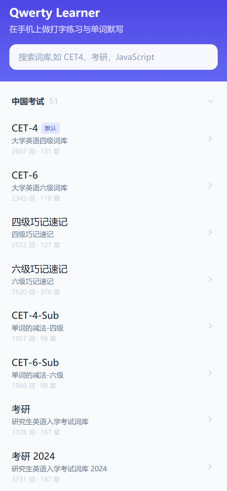
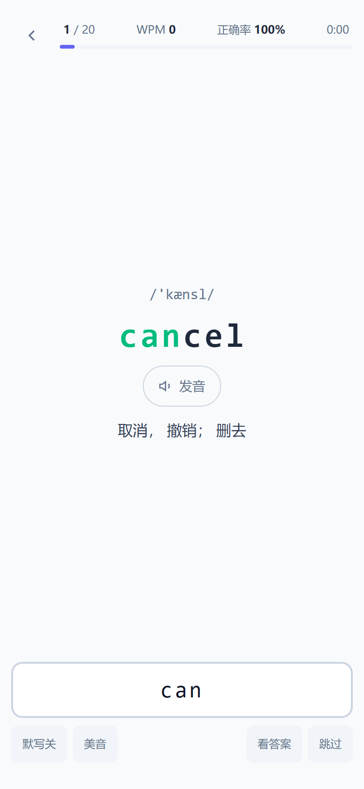
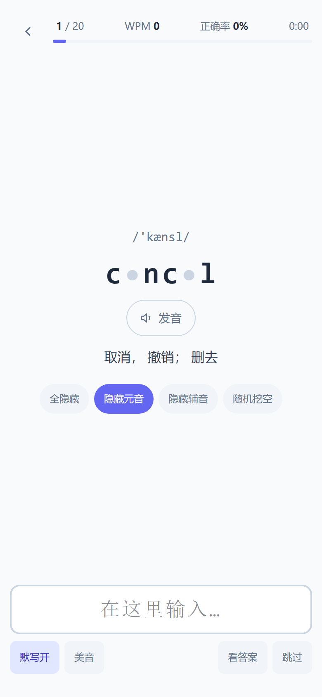
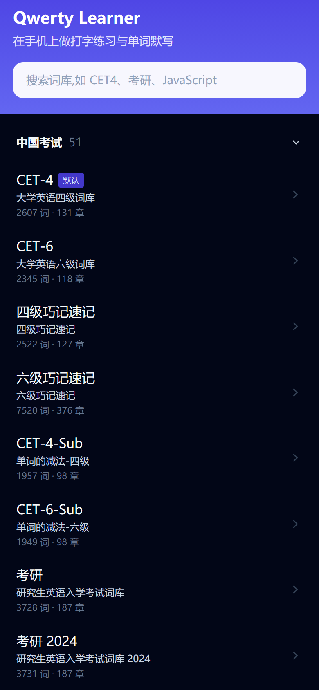

# Qwerty Learner 手机版

把 [Qwerty Learner](https://github.com/RealKai42/qwerty-learner) 移植成**手机上真正能用**的 PWA —— 打字练习 + 默写模式。

## 界面预览

<p align="center">
  
  
  
  <br />
  <sub>词库列表(368 个词库) · 打字练习(打对的字母变绿) · 默写模式(挖空元音)</sub>
</p>

<p align="center">
  
  <br />
  <sub>深色模式(跟随系统,也可手动切换)</sub>
</p>

---

## 来源与许可证(重要)

本项目是 [**RealKai42/qwerty-learner**](https://github.com/RealKai42/qwerty-learner) 的衍生作品。上游以 **GNU GPL-3.0** 发布,本项目**同样以 GPL-3.0 发布**,完整许可证见 [LICENSE](./LICENSE)。

按照 GPL-3.0 的要求,在此明确声明:

| 项目 | 说明 |
|---|---|
| 上游项目 | [RealKai42/qwerty-learner](https://github.com/RealKai42/qwerty-learner) |
| 上游作者 | [Kaiyi (RealKai42)](https://github.com/RealKai42) |
| 上游许可证 | GPL-3.0 |
| 本项目许可证 | **GPL-3.0**(与上游一致) |
| 本项目的源码 | 本仓库(公开可访问,满足 GPL 源码提供义务) |

### 复用了上游的什么

- `public/dicts/` 的 **368 个词库 JSON**(约 72 MB)—— 原样复制,未修改内容
- `public/sounds/` 的 **17 个音效文件** —— 原样复制
- `src/resources/dictionary.ts` 的**词库目录元数据** —— 由 `scripts/extract-catalog.mjs` 提取为 `catalog.json`
- 判定逻辑与统计公式的**行为规格**(逐条对齐,见下文「与上游的一致性」)

### 本项目新建的部分

上游的练习界面是为**物理键盘**设计的(依赖全局 `keydown` 监听 + 整块键盘可视化组件),在手机上不成立,因此界面层是重写的:

- 移动优先的触摸界面,全部输入走**系统输入法**
- 词库**按需加载** + Service Worker 缓存(不把 72 MB 打进主包)
- PWA:可「添加到主屏幕」、离线可用
- 发音改用**浏览器内置 TTS**(Web Speech API),不依赖外部 CDN
- 使用了现代的 Vite 8 / React 19 / Tailwind 4 构建链(上游为 Vite 4 / React 18 / Tailwind 3)

---

## 为什么需要这个移植

上游官网 https://qwerty.kaiyi.cool/ 在手机上**无法实际练习**:

1. 视口 ≤ 600px 时,上游路由强制跳转到 `/mobile`
2. 而 `/mobile`(上游 `src/pages/Mobile/index.tsx`)是一个**营销落地页** —— 轮播图、功能截图、用户评价、SEO 文案,没有任何练习功能
3. 该页唯一的行动按钮「立即开始」又指回首页,于是再次因视口 ≤ 600px 跳回 `/mobile`

**结果:手机用户在宣传页里死循环,永远进不到练习界面。**

---

## 功能

- **打字练习** —— 显示单词 / 音标 / 释义,输入打分,实时 WPM 与正确率
- **默写模式** —— 四种挖空方式:全隐藏、隐藏元音、隐藏辅音、随机挖空
- **发音** —— 点击朗读,支持美音 / 英音切换
- **词库浏览** —— 368 个词库,按分类折叠 + 关键词搜索,记住每个词库的练习进度
- **离线可用** —— 装到主屏幕后,已下载过的词库断网也能练

## 与上游的一致性

判定与统计逻辑**逐条对齐**上游源码,并有单元测试锁定([`src/lib/typing.test.ts`](./src/lib/typing.test.ts) 等):

| 项目 | 上游出处 | 取值 |
|---|---|---|
| 每章词数 | `src/constants/index.ts` | `CHAPTER_LENGTH = 20` |
| WPM | `store/index.ts:201` | `round(wordCount / 秒数 * 60)`(按**单词**计,非按字符) |
| 正确率 | `store/index.ts:200` | `round(correct / (correct + wrong) * 100)` |
| 逐字符判定 | `Word/index.tsx:184` | 默认忽略大小写(`isIgnoreCase = true`) |
| 打错处理 | `Word/index.tsx:237-251` | 标红 → 300ms 后**清空整词,必须从头重打** |
| 元音表 | `Word/index.tsx:32` | `['A','E','I','O','U']` |
| 随机挖空 | `Word/index.tsx:70` | 每字母 `Math.random() > 0.4` 可见(隐藏约 40%) |

**一处有意的差异:** 上游用「拒绝错误按键」的方式判定;本项目改为「接受输入 → 标红 → 清空重打」。原因是手机输入法会缓冲整段文字(组合态),拒绝式判定会和输入法的组合态打架。防错记的目标不变 —— 带着错误无法进入下一个单词。

---

## 已知限制

### ⚠️ 输入法:网页无法强制切换到英文键盘

这是「用系统输入法」这条路线的固有代价,必须说清楚:

**能做的**(已全部实现):
- `autocorrect="off"` / `autocapitalize="off"` / `autocomplete="off"` / `spellcheck="false"` —— 关掉一切自动更正
- 正确处理**输入法组合态**(`compositionstart` / `compositionend`),即使用中文输入法也不会被判错
- `inputmode="latin"`(非标准取值,用 `setAttribute` 尽力设置)—— 部分安卓输入法据此切到英文键盘

**做不到的**:
- **无法强制**把用户的输入法从中文切到英文。输入法选择是系统级设置,只能由用户在键盘上手动切换(地球键 / 中英切换键)
- **无法移除**键盘上方的联想候选栏(iOS QuickType、安卓各家候选栏)。只能保证它不自动替换 —— 若手滑点了候选词,那个词会被判错

> 实测建议:练习时手动把键盘切到英文。若联想栏干扰太大,可考虑后续加一个「内置键盘」开关 —— 输入层已抽象成 [`PracticeInput.tsx`](./src/components/PracticeInput.tsx) 单个组件,替换它不影响其余代码。

### 其它

- 音标并非所有词库都有(如程序员词库 `go_keyword` 就没有),界面会自动隐藏音标行
- 第一版只做打字练习与默写模式,**未包含**:错词本、学习统计图表。上游有这些功能,可作为后续迭代方向
- 进度存在 `localStorage`(数据量很小);上游用 IndexedDB 是因为它要存每次按键的明细用于分析图表

---

## 开发

```bash
npm install          # 安装依赖

# 从上游同步数据(词库 / 音效 / LICENSE),三步:
node scripts/fetch-upstream.mjs  # 拉取上游源码副本到 .upstream/(自动在 git clone 与 tarball 快照间降级)
node scripts/extract-catalog.mjs .upstream/qwerty-learner-master src/data/catalog.json
node scripts/prepare-data.mjs    .upstream/qwerty-learner-master
node scripts/generate-icons.mjs  # 生成 PWA 图标

npm run dev          # 开发服务器
npm test             # 单元测试(vitest)
npm run build        # 构建到 dist/
npm run preview      # 本地预览构建产物
```

> `.upstream/` 只是构建期的中间产物,不需要提交。词库与音效会被复制进 `public/`,
> 所以 `public/` 下约 72 MB 的数据是随仓库分发的(这是 GPL-3.0 允许的再分发)。

### 部署到 GitHub Pages

推送到 `main` 分支后,`.github/workflows/deploy.yml` 会自动构建并发布。

**首次需要在仓库里设置一次:** Settings → Pages → Build and deployment → Source 选择 **GitHub Actions**。

如果仓库名不是 `qwerty-mobile`,需要把 `vite.config.ts` 里的默认 base 改成 `/<你的仓库名>/`,或在构建时设置环境变量 `BASE_PATH`。

---

## 技术栈

Vite 8 · React 19 · TypeScript · Tailwind CSS 4 · vite-plugin-pwa(Workbox 7)

## 许可证

**GPL-3.0**,与上游一致。详见 [LICENSE](./LICENSE)。
